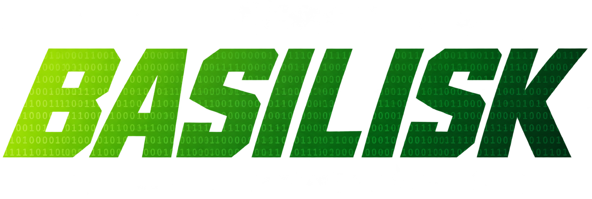

<p align="center">
  
</p>

<p align="center">
  
</p>

<p align="center">
  An open-source, Rust-based virtualizing obfuscator for <a href="https://luau.org/">Luau</a>.
</p>

It transforms Luau source into a custom bytecode representation and generates a specialized Luau virtual machine to execute it. A build produces a standalone Luau script containing the generated VM and protected payload. Per-build variation in instruction encoding and VM structure makes the result more difficult to analyze and reconstruct.

Basilisk is also a compiler project: its Rust workspace includes a Luau frontend, an intermediate representation, transformation passes, a bytecode encoder, and a VM generator.

## Features

- **Virtualization:** lowers Luau into a custom instruction set executed by a generated Luau VM.
- **Per-build VM variation:** varies opcode mappings, operand roles, dispatch structure, and handler implementations using a build seed.
- **Protected constants:** encodes constants and resolves them through authenticated access paths rather than exposing a single plaintext constant pool.
- **Paged instruction decoding:** decodes instructions incrementally in pages instead of materializing the entire instruction stream at once.
- **Code transformations:** control-flow flattening, opaque predicates, junk/dead-code insertion, and selected fused operations.
- **Source macros:** a `BASIL_*` macro surface lets scripts opt into sealed functions, authenticated values, inlining, and more (see [docs/MACROS.md](docs/MACROS.md)).
- **Optional output features:** surface transformations (meme weaving, type-annotation noise) and ownership/canary notices.

Features and defaults vary by build configuration. Run `basilisk --help` for the complete set of options.

## Getting started

### Requirements

- A recent stable [Rust](https://www.rust-lang.org/tools/install) toolchain with Cargo (Rust edition 2021).
- The [Luau CLI](https://github.com/luau-lang/luau) to execute protected output and run tests that compare it with unprotected Luau. Luau is not required to compile Basilisk.

### Build

```sh
cargo build --release
```

The executable is written to `target/release/basilisk` (or `target/release/basilisk.exe` on Windows).

### Obfuscate a script

Create `input.luau`:

```lua
local function greet(name)
    return "Hello, " .. name .. "!"
end

print(greet("escalibur"))
```

Then build and run the protected script:

```sh
./target/release/basilisk --seed 7 input.luau output.lua
luau output.lua
```

The output should be:

```text
Hello, escalibur!
```

The `--seed` option makes a particular build reproducible; changing it can change the generated VM and encoded payload.

## CLI options

```text
basilisk [OPTIONS] <INPUT> <OUTPUT>
```

A selection of useful options:

| Option | Description |
| --- | --- |
| `--seed <N>` | Select the seed for VM and encoding variation. |
| `--flatten` | Enable control-flow flattening. |
| `--opaque` / `--no-opaque` | Control opaque-predicate insertion. |
| `--fuse` / `--no-fuse` | Control selected operation fusion. |
| `--junk` | Insert junk or dead-code transformations. |
| `--no-minify` | Emit a more readable VM for debugging and inspection. |
| `--compress` | Compress the serialized payload. |
| `--target-profile <P>` | Select target-specific defaults (for example, `cli-test`, `executor`, or `studio`). |
| `--shell-family <F>` | Choose the generated top-level wrapper when surface mode is on: `auto`, `iife`, `table-entry`, `helper-launcher`, or `setmeta` (a top-level `return setmetatable(...)`). Surface mode is on by default for release profiles such as `executor`, or force it with `--lura-surface`. |
| `--surface-memes` | Weave distracting strings through the generated output (see below). |

Use `basilisk --help` for the authoritative list of flags, supported profiles, and defaults.

### Surface weaving

The generated output can optionally be woven with distracting strings, which changes how the script looks without changing what it does. Enable it with `--surface-memes`:

```sh
./target/release/basilisk --seed 7 --surface-memes input.luau output.lua
```

Surface features are off by default.

## Macros

Scripts can opt into specific Basilisk behaviours from their own source using `BASIL_*` macros:
for example, sealing a function body (`BASIL_ENCFUNC`), inlining a small helper (`BASIL_INLINE`),
or emitting a seed-polymorphic opcode bundle (`BASIL_OPCODE`). Macros are expanded before
compilation and every `BASIL_` name is stripped from the artifact.

```lua
local add = BASIL_INLINE(function(a, b) return a + b end)
print(add(2, 3))
```

See **[docs/MACROS.md](docs/MACROS.md)** for the full list, syntax, restrictions, and examples.

## Playground

Try Basilisk in your browser at **[playground.escaliba.net](https://playground.escaliba.net)**. The
real engine is compiled to WebAssembly and runs entirely client-side (nothing is uploaded, and
submitted Luau is never executed, only obfuscated).

To build and serve it locally (needs `wasm-pack` and the `wasm32-unknown-unknown` target):

```sh
bash playground/build.sh
python3 -m http.server -d playground/web 8080
# open http://localhost:8080
```

## Roblox compatibility

Virtualized output runs on Roblox with one documented exception: `obj:method()` resolves through `__index` rather than firing `__namecall`. See [docs/COMPATIBILITY.md](docs/COMPATIBILITY.md) for the details and the Studio test procedure.

## Project structure

Basilisk is organized as a Cargo workspace:

| Path | Purpose |
| --- | --- |
| `crates/frontend` | Luau parsing, desugaring, and lowering to IR, using [`full_moon`](https://crates.io/crates/full_moon). |
| `crates/ir` | Intermediate representation shared by compiler passes. |
| `crates/passes` | Code transformations and obfuscation passes. |
| `crates/bytecode` | Custom instruction set, serialization, and protected container encoding. |
| `crates/vmgen` | Per-build Luau VM generation. |
| `crates/pipeline` | Build pipeline and pass orchestration. |
| `crates/cli` | The `basilisk` command-line interface. |
| `crates/surface` | Supporting output functionality. |
| `runtime/vm_template.luau` | Luau VM template specialized by the generator. |

## Development

```sh
cargo test
cargo fmt --all -- --check
cargo clippy --all-targets
```

The test suite covers Luau language behavior, bytecode and VM generation, and protected-versus-original execution. Some integration and conformance tests require the Luau CLI.

Contributions and bug reports are welcome; see [CONTRIBUTING.md](CONTRIBUTING.md) for guidelines.

## Security considerations

Basilisk is designed to increase the effort required to inspect, understand, and reconstruct Luau programs. It does not guarantee that protected code cannot be recovered: a runtime able to execute a program can also be observed or instrumented, so obfuscation raises cost rather than providing cryptographic secrecy. **Never embed secrets in client-side scripts and rely on obfuscation to keep them private.** Secure server-side logic and credentials independently.

If you discover a security issue, please follow the guidance in [SECURITY.md](SECURITY.md) rather than publishing sensitive details immediately.

## Community

Questions, ideas, and bug reports are welcome on the [Discord server](https://discord.gg/2pTDtk56w4).

## About

Basilisk was originally developed for [Sentinel](https://sentinel.bz). This repository contains the standalone obfuscator; hosted services, deployment infrastructure, and product-specific integrations are not included.

Developed by **[escaliba](https://escaliba.net)** (also known as baba and zyu).

## License

Basilisk is licensed under the [MIT License](LICENSE). Third-party dependencies remain under their respective licenses.

Scripts you generate with Basilisk carry an additional permission ([LICENSE-EXCEPTION](LICENSE-EXCEPTION)): you may use, modify, distribute, and sell them without including Basilisk's MIT notice or attribution.